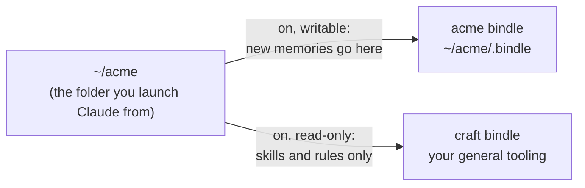

# bindle

bindle carries your Claude Code setup (skills, hooks, memory, notes and rules) between machines in git, while keeping each part of your life, such as personal projects, an employer or each client, in its own repo that never mixes with the others.

You keep one repo per domain, called a **bindle**. Each folder you launch Claude Code from turns on the bindles it needs. A work session can use your general tooling, but it can't write work context into your personal repo, and a client's knowledge never reaches another client's folder.

Contents: [How it works](#how-it-works) · [Install](#install) · [Quick start](#quick-start) · [Everyday use](#everyday-use) · [Scenarios](#scenarios) · [Commands](#commands) · [Configuration](#configuration) · [Safety](#safety-and-boundaries) · [Updating](#updating) · [Troubleshooting](#troubleshooting) · [Limits](#limits)

## How it works

| Term | Meaning |
|---|---|
| **Bindle** | A git repo for one domain: its skills, commands, hooks, memory, notes and rules. Technically, a Claude Code plugin with a few extra folders. |
| **Domain** | A boundary you want to keep: you, an employer, one client. One bindle per domain. |
| **Attach** | Turn a bindle on for a folder. Every session started from that folder loads it. |
| **Writable** | The one attached bindle that new memories are saved to. A folder has at most one. |
| **Read-only** | Any other attached bindle. Its skills, rules and memories load, but sessions can't edit it. |
| **Promotion** | The only way material moves between bindles: a general rewrite you approve, checked for domain names and secrets on the way out. |

A typical setup at work, launching Claude Code from `~/acme`:



Your personal bindle isn't attached at `~/acme` at all, so nothing personal loads there. At home, `~/projects` attaches your personal bindle as writable instead.

bindle uses Claude Code's own mechanisms rather than replacing them: plugins for skills and hooks, the `autoMemoryDirectory` setting for memory, and permission rules for the read-only lock. The `bindle` command stores nothing itself; it writes a folder's `.claude/settings.local.json` and reads it back.

## Install

You need Claude Code 2.1.74 or later, git, and Python 3.9 or later. It runs on macOS, Linux and Windows.

```
git clone https://github.com/ghaldring9294/bindle.git
bindle/bin/bindle install
```

`install` puts the `bindle` command in `~/.local/bin` and adds two things to `~/.claude`: the `/bindle` command and the `/bindle-promote` skill. It never touches your settings or `CLAUDE.md`. If `~/.local/bin` isn't on your `PATH`, it tells you how to add it.

**On Windows:** install [Git for Windows](https://git-scm.com/download/win) (Claude Code runs hooks in its Git Bash) and Python from [python.org](https://www.python.org/downloads/), then run the same two lines from a terminal, with `python bindle\bin\bindle install` for the second. Without developer mode, Windows doesn't allow symlinks, so `install` copies files instead and writes a `bindle.cmd` launcher; run `bindle install` again after updating bindle. Add `%USERPROFILE%\.local\bin` to your `PATH`.

## Quick start

Create a personal bindle and turn it on for the folder you keep side projects in. These examples keep bindles in `~/bindles/`; any folder works.

1. **Create the bindle.** It's a local git repo; bindle never sets a remote.
   ```
   bindle new personal --at ~/bindles/personal --sync
   ```
2. **Give it a private remote** so it can travel between machines (any git host):
   ```
   cd ~/bindles/personal
   git remote add origin git@github.com:you/bindle-personal.git
   git push -u origin main
   ```
3. **Attach it** to the folder you launch Claude Code from, as the writable bindle:
   ```
   bindle attach ~/bindles/personal ~/projects --writable
   ```
4. **Check it:**
   ```
   bindle doctor ~/projects
   ```
   You should see `personal: on, writable, sync on` and `No problems found.`
5. **Start Claude Code from `~/projects`.** The first lines of the session name the bindle and say it's writable. Ask Claude to remember something; it lands in `~/bindles/personal/memory/`, and with sync on, it's committed and pushed when the session ends.

On another machine: clone the bindle, run `bindle install` once, and `bindle attach` once per folder.

## Everyday use

**What loads when you start Claude Code in a folder:**

| From each attached bindle | Writable bindle | Read-only bindle |
|---|---|---|
| Skills, commands, agents, hooks (named `<bindle>:<name>`) | yes | yes |
| `rules.md` (standing instructions) | yes | yes |
| `memory/MEMORY.md` (the memory index) | yes, by Claude Code | yes, shown by the bindle's hook |
| Where its notes are, and uncommitted work to commit | yes | no |

Bindles not attached to the folder contribute nothing. Individual memory files load on demand when the index points to something relevant.

**Memory.** Claude saves new memories into the writable bindle's `memory/`. A memory about only one project goes in `projects/<project>/` with that folder's own `index.md`, and `MEMORY.md` keeps one pointer line per project, so the index loaded at every start stays short.

**Sync.** With `"sync": true` in `bindle.json`, each session start pulls the latest from the bindle's remote, and each session end commits changes under `memory/` and `outbox/` and pushes them. Without a remote, it commits locally. Everything else (skills, rules, notes) you commit yourself; the session start reminds you when something's waiting. `bindle sync` does the same on demand.

**Notes.** Each bindle has a `notes/` folder for anything you want to keep: ticket notes, plans, research. Notes aren't loaded automatically; the session is told where they are. `notes/scratch/` is ignored by git, for things that should never leave the machine.

**Rules.** A bindle's `rules.md` is shown at every session start where it's attached, as standing instructions. Keep it short (it must stay under 9,000 characters) and put detail in memory or notes.

## Scenarios

Each scenario uses made-up names. Replace the paths with your own.

**An employee.** Your employer's bindle lives in your work folder and is writable there; your general tooling (a craft bindle) is on read-only.
```
bindle new acme --at ~/acme/.bindle
bindle attach ~/acme/.bindle ~/acme --writable
bindle attach ~/bindles/craft ~/acme
```

**A freelancer with two clients.** Each client gets a folder and a bindle. Switching clients means starting Claude Code from the other folder, which also gives you separate session histories and permissions.
```
bindle attach ~/clients/acme/.bindle ~/clients/acme --writable
bindle attach ~/clients/globex/.bindle ~/clients/globex --writable
bindle attach ~/bindles/craft ~/clients/acme
bindle attach ~/bindles/craft ~/clients/globex
```

**A client that allows no outside tooling.** Attach only that client's bindle to its folder.

**A new machine.** Clone your bindles, run `bindle install`, then `bindle attach` once per folder. A folder's attach settings stay on that machine, so this is the only setup step.

**Promoting a lesson.** In the session where you learned it, ask Claude to promote it (the `/bindle-promote` skill). It drafts a general rewrite, you approve it, and it goes into the source bindle's outbox after a check against that bindle's private terms. Then collect it into the target:
```
bindle collect ~/acme/.bindle --into ~/bindles/personal --items small-prs
```

**Sharing your craft.** Keep finished, general skills in a craft bindle that only takes promoted material, and share its repo. Anyone with access can install it as an ordinary plugin, with no bindle needed:
```
bindle new craft --at ~/bindles/craft --audience shared --writes explicit
```
```
/plugin marketplace add git@github.com:you/bindle-craft.git
```

**The same tools on every machine.** Put the domain's MCP servers in its bindle's `.mcp.json` (see [Configuration](#configuration)), with secrets as environment variables. On each machine, set the variables once; every folder the bindle is attached to then has the same tools.

**Working with a friend on a project.** You each keep your own bindles. Anything you both need goes into the project's repo itself (its `CLAUDE.md` and docs), where it's reviewed like code.

## Commands

| Command | What it does |
|---|---|
| `bindle install` | Link `bindle` onto your `PATH`, and `/bindle` and `/bindle-promote` into `~/.claude` |
| `bindle new <name> [--at <dir>] [--sync] [--audience …] [--writes …]` | Create a bindle repo (default location `./.bindle`) |
| `bindle attach <bindle> [<folder>] [--writable]` | Turn a bindle on for a folder; `--writable` makes it the one new memories go to |
| `bindle detach <name-or-path> [<folder>]` | Turn a bindle off for a folder |
| `bindle doctor [<folder>]` | Show what's on, what's writable, unsaved work, warnings and problems, with the command that fixes each problem |
| `bindle sync [<folder>]` | Pull the bindles that are on; commit and push the writable one's memories |
| `bindle upgrade [<bindle>] [--dry-run]` | Bring a bindle's managed files up to this version of bindle |
| `bindle outbox add <bindle> <draft> --name <slug> [--kind …] [--description …]` | Store an approved draft for promotion, after the leak and secret checks |
| `bindle outbox list <bindle>` | Show a bindle's outbox |
| `bindle collect <source> --into <target> --items <slugs>` | Move approved outbox items into another bindle |

`<folder>` always means the folder you start Claude Code from; it defaults to the current one. Run `bindle <command> --help` for every option.

## Configuration

**A bindle's layout:**

```
bindle.json            name, layout version, sync, audience, writes
.claude-plugin/        the plugin manifest (its name is the prefix: acme:<skill>)
skills/ commands/ agents/
hooks/                 managed by bindle; don't edit (doctor flags changes)
memory/                MEMORY.md plus one file per memory
projects/<project>/    memories and notes about one project
notes/                 your notes; notes/scratch/ is never committed
rules.md               standing instructions for this domain
private-terms.txt      names that must never leave this bindle
outbox/                approved items waiting to be collected
AGENTS.md              orientation for AI agents working in the bindle
```

**`bindle.json`:**

| Field | Values | Effect |
|---|---|---|
| `name` | lowercase letters, digits, hyphens | The bindle's name, and the prefix of its skills. Pick it for how you'll type it. |
| `sync` | `true` / `false` | Pull at session start; commit and push `memory/` and `outbox/` at session end |
| `audience` | `private` / `shared` / `public` | Who the bindle is for. Visibility itself is your git host's setting. |
| `writes` | `implicit` / `explicit` | `explicit` bindles take material only through `bindle collect` and can't be writable |

**`private-terms.txt`:** one name per line (organization, products, repos, ticket prefixes, people). Matching ignores case and whole words only; a term ending in punctuation, like the ticket prefix `ACME-`, also matches what follows it. Anything promoted out of the bindle is checked against these.

**What `attach` writes** into the folder's `.claude/settings.local.json` (shown for a writable bindle; nothing is copied or linked):

```json
{
  "extraKnownMarketplaces": {
    "bindle-acme": { "source": { "source": "directory", "path": "/Users/you/acme/.bindle" } }
  },
  "enabledPlugins": { "acme@bindle-acme": true },
  "autoMemoryDirectory": "/Users/you/acme/.bindle/memory"
}
```

A read-only bindle gets a permission rule instead of `autoMemoryDirectory`: `"permissions": { "deny": ["Edit(//Users/you/bindles/craft/**)"] }`.

**MCP servers.** To have the same tools on every machine where a domain is attached, put its MCP servers in the bindle's `.mcp.json`. Claude Code starts them in every session where the bindle is on, and their tools are named `mcp__plugin_<bindle>_<server>__<tool>`. Keep secrets out of the file: refer to environment variables, which each machine sets (from a password manager or your shell profile), and use `${CLAUDE_PLUGIN_ROOT}` for files inside the bindle.

```json
{
  "mcpServers": {
    "tracker": {
      "command": "npx",
      "args": ["-y", "some-tracker-mcp"],
      "env": { "TRACKER_TOKEN": "${ACME_TRACKER_TOKEN}" }
    },
    "helper": {
      "command": "python3",
      "args": ["${CLAUDE_PLUGIN_ROOT}/servers/helper.py"]
    }
  }
}
```

A server that only exists on one machine (a local path, a tool installed in one place) stays in that machine's own setup (`claude mcp add --scope user`), with a line in the bindle's `notes/` saying how to add it. Connectors that come with your Claude account follow your login and need no setup. A read-only bindle's servers run code on your machine, so `doctor` lists them under Warnings.

**What's in git, and what isn't:**

| In git (carried to every machine) | Not in git (stays on the machine) |
|---|---|
| Each bindle's memories (committed at session end with sync on) | Uncommitted edits in a bindle (`doctor` shows them) |
| A bindle's MCP server definitions (`.mcp.json`) | The secrets they read from environment variables |
| Everything else you commit in a bindle | `notes/scratch/` and anything else a bindle ignores |
| The bindle tool itself | Your Claude Code setup outside bindles: `~/.claude/CLAUDE.md`, `settings.json`, skills not in a bindle, MCP servers, session history |
| | A folder's attach settings (recreated with `bindle attach`) |

## Safety and boundaries

- **One writable bindle per folder.** Every new memory has exactly one destination, so a session can't save work context into your personal bindle by mistake.
- **Read-only bindles are locked against Claude's file-editing tools.** `attach` adds a permission rule, so Claude can't edit them. It isn't a sandbox: it doesn't cover shell commands, though Claude Code refuses attempts to work around the lock that way.
- **Promotion is the only way bindle moves material between bindles.** Material crosses as a general rewrite you approved. `outbox add` checks it against the source's private terms (in its name, description, file names and contents) and for credentials, and records a hash; `collect` refuses anything that changed since you approved it, and names its items, so Claude Code's permission prompt shows exactly what moves. The private terms are a backstop for names you've listed, not a guarantee.
- **A read-only bindle is visible, not sealed.** Its rules and memory index are shown in sessions where it's attached, so what a session sees there could end up in the writable bindle's memories. Attach a bindle to a folder only if that domain may see it, which is why personal stays off at work and craft holds only general material.
- **Secrets are never committed by sync.** A memory or outbox file that looks like it holds a credential stops the commit, and `doctor` reports it. `doctor` also checks notes and suggests moving a secret to a password manager, leaving a pointer in the note.
- **A bindle inside a project repo is excluded there.** `bindle new` adds it to that repo's `.git/info/exclude`, so a `git add -A` in the project can't commit your bindle. `doctor` warns if a repo would commit or already tracks one.
- **bindle never adds or pushes a remote.** Where each bindle lives is your decision. A work bindle belongs only on storage your employer allows.
- **Trust what you attach.** A bindle's hooks and servers run with your permissions, and its skills and rules are instructions to Claude. Attach only bindles you control or trust. `attach` and `doctor` warn when a read-only bindle runs code beyond bindle's own hooks, and if a sync pulls changes to such code, the session says so before it next runs. These are warnings, not blocks: you decide.

## Updating

```
git -C <path-to>/bindle pull     # the bindle command is a link into this repo
bindle doctor <folder>           # says which bindles need upgrading, with the command
```

`doctor` prints a ready-to-run `bindle upgrade` for each bindle that's behind. A bindle that's read-only in the folder is locked to Claude, so run that upgrade yourself (in Claude Code, prefix it with `!`). [CHANGELOG.md](CHANGELOG.md) lists what changed in each version, and says when an upgrade is needed.

## Troubleshooting

Start with `bindle doctor <folder>`; it explains most problems and prints the fix.

| Symptom | Cause and fix |
|---|---|
| `doctor` says nothing is at a bindle's path | The bindle moved. Attach it again from its new path. |
| A skill shows up twice | An old copy is still in `~/.claude/skills/`. Remove it; the bindle provides it now. |
| Memories didn't reach the other machine | Closing the app or killing the terminal can skip the end-of-session sync; the next session start in that folder commits and pushes them. `bindle sync` does it now. `doctor` shows the last sync result. |
| Sync says "push failed" | Usually credentials. With two GitHub accounts on one machine (say work and personal), the credential manager may offer the wrong one. Put the account in the remote URL so git asks for it once and remembers it per repo: `git -C <bindle> remote set-url origin https://<user>@github.com/<user>/<repo>.git`, then `git -C <bindle> push` by hand. Over SSH, use a host alias per account. |
| Sync refused to commit | A memory looks like it holds a credential. `doctor` names the file; remove the secret. |
| "attach refuses a folder inside a git repo" | Claude Code reads settings at the repo root. Attach the repo root, or a folder that isn't inside a repo. |
| "read-only but not locked" | The bindle was attached before locks existed. Run the same `bindle attach` again. |
| Rules seem ignored | `doctor` warns when `rules.md` is over 9,000 characters; the hook can show only 10,000. |

## Limits

- **Windows needs Git for Windows and Python.** Hooks run through Git Bash and find Python as `python3`, `python` or `py`. On Windows, Claude Code reads a folder's settings in that folder, so `attach` accepts a folder inside a repo there.
- **Claude Code shows only the first 200 lines or 25 KB of `MEMORY.md`.** Keep the index short; put project memories in `projects/`.
- **A read-only bindle's memory index is shown through a hook, capped at 10,000 characters.**
- **A repo's notes don't load automatically when you work inside that repo.** Launch from the folder that holds your repos, and the session is told where the notes are.
- **Attach settings are per machine.** Each machine runs `bindle attach` once per folder.

## For contributors

- `python3 -m unittest discover -s tests` runs the unit tests (a fake `claude`, fast); `tests/e2e.sh` runs the main flow against the real Claude Code. CI runs the unit tests on macOS and Linux.
- [docs/design.md](docs/design.md) explains the design and why it works this way; [PLAN.md](PLAN.md) has the status and next steps; [AGENTS.md](AGENTS.md) orients AI agents working on this repo; [MIGRATION.md](MIGRATION.md) is what Claude follows to move an existing setup into bindles.
