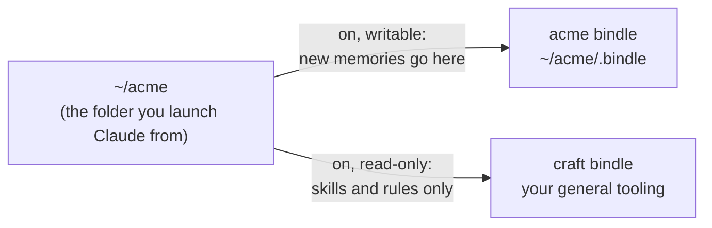

# bindle

[](https://buymeacoffee.com/ghaldring9294)

**Git-portable, domain-scoped Claude Code context.**

You build a skill at a meetup and want to bring it to work. At work you improve it, and you want to show the improved version at the next meetup — but work's version has your employer's conventions baked in. bindle solves this: your general tooling travels between machines in git, each domain's context stays in its own lane, and when something is worth sharing back, **promotion** rewrites it into a general form you approve, checked for private names and secrets.

**Two bindles cover most setups.** A **craft** bindle is your portable CLAUDE.md — rules, skills and memories that load in every session on every machine (`bindle global craft`). A **domain** bindle holds one employer's or client's context and loads only in that folder. You use bindle through Claude, in plain language: "attach craft here", "make a bindle for ~/acme", "promote this lesson to craft".

[Full documentation](docs/reference.md) · [Install](#install) · [Getting started](#getting-started) · [How it works](#how-it-works) · [Day to day](#day-to-day) · [Scenarios](#scenarios)

## Install

You need Claude Code 2.1.74 or later, git, and Python 3.9 or later. It runs on macOS, Linux and Windows. On Windows, install [Git for Windows](https://git-scm.com/download/win) (Claude Code runs hooks in its Git Bash) and Python from [python.org](https://www.python.org/downloads/).

In Claude Code, run:

```
/plugin marketplace add https://github.com/ghaldring9294/bindle.git
/plugin install bindle@bindle --scope user
```
If the remote URL doesn't work, clone the repo first and add it by local path:
```
git clone https://github.com/ghaldring9294/bindle.git
/plugin marketplace add /path/to/bindle
/plugin install bindle@bindle --scope user
```
Adding the marketplace only makes the plugin available; the install turns it on, and user scope turns it on in every folder (your bindles still load only where you attach them). This gives you the `/bindle` command, the `/bindle:promote` and `/bindle:onboard` skills, MCP tools that Claude calls directly (attach, detach, doctor, sync and so on — no shell commands needed), and the session-check hook that warns when a session starts inside a domain folder without its bindle, and when bindle or a bindle needs updating. Nothing else to install; next, [get started](#getting-started).

The session check warns inside folders you've attached a bindle to as writable; everywhere else it stays silent. In any folder, it also says when bindle has a new release (it checks for new tags in the background, at most once a day; set `BINDLE_UPDATE_CHECK=off` to stop that) or when a bindle needs `bindle upgrade`.

## Getting started

Start Claude Code in any folder. With no bindles yet, the session's first lines offer `/bindle:onboard`, which walks you through setup: a **craft** bindle for the rules and skills you want in every session, your first rule, a demo of how a domain bindle keeps one context to its own folder, and a remote so it all travels between machines. If you already have bindles on another machine, it clones them instead. You don't type any `bindle` commands; Claude runs them.

After that, ask Claude in your own words:

| Ask | What happens |
|---|---|
| "attach craft here" | craft turns on for this folder, read-only |
| "make acme writable here" | new memories from this folder go to acme |
| "make craft's rules apply everywhere" | craft's rules load in every session, subagent and folder |
| "what's on here?" | Claude checks the folder and summarizes what's on and anything wrong |
| "make a bindle for ~/acme" | a new domain bindle, with its private terms, writable in that folder |
| "promote this lesson to craft" | Claude drafts a general version; it moves only once you approve |
| "remind me in globex to send the invoice" | a note waits for the next session in globex's folder |
| "update bindle" | pulls and upgrades every bindle |

Changes to what's attached take effect in your next session, since Claude Code reads settings when a session starts. `/bindle` teaches Claude bindle in any session, and `/bindle:docs` links to these docs.

## How it works

| Term | Meaning |
|---|---|
| **Bindle** | A git repo for one domain: its skills, commands, hooks, memory, notes and rules. Technically, a Claude Code plugin with a few extra folders. |
| **Domain** | A boundary you want to keep: an employer, one client, your side projects. One bindle per domain. |
| **Craft** | A bindle of general rules and skills with nothing from any one domain, turned on wherever you work. |
| **Attach** | Turn a bindle on for a folder. Every session started from that folder loads it. |
| **Writable** | The one attached bindle that new memories are saved to. A folder has at most one. |
| **Read-only** | Any other attached bindle. Its skills, rules and memories load, but sessions can't edit it. |
| **Promotion** | The only way material moves between bindles: a general rewrite you approve, checked for domain names and secrets on the way out. |

A typical setup at work, launching Claude Code from `~/acme`:



Any other domain's bindle isn't attached at `~/acme`, so nothing from it loads there; in that domain's own folder, its bindle is the writable one instead.

bindle uses Claude Code's own mechanisms rather than replacing them: plugins for skills and hooks, the `autoMemoryDirectory` setting for memory, and permission rules for the read-only lock. The `bindle` command writes a folder's `.claude/settings.local.json` and reads it back; the only thing it keeps is `~/bindles/registry.json`, a plain list of where your bindles live, so you can name them from any folder.

## Day to day

**Bindles are git repos.** Each one is a local repo. You add a remote to any git host (GitHub, a private server, whatever your employer allows), and sync handles the rest: each session start pulls, each session end commits and pushes your memories and notes. On a new machine, clone the repo and `bindle attach` once per folder — your full context is there.

**Two kinds of bindle, by design.** A **domain** bindle (`implicit` writes) is writable: memories save there automatically during a session. A **craft** bindle (`explicit` writes) takes material only through promotion — nothing lands in it by accident. This is intentional: craft loads in every session on every machine (`bindle global craft`), so everything in it should be general and worth carrying everywhere. Keep craft lean; put domain-specific detail in the domain's bindle.

**Craft changes go through promotion.** When you say "add this to my craft" or "remember this in craft", Claude reaches for promotion: it drafts a general version stripped of domain specifics, checks it against the source bindle's private terms and secrets, and puts it in craft only once you approve. The same flow works for skills, rules, and any other file. This is how a lesson learned at work becomes general tooling without leaking your employer's context.

**Memories travel; some are machine-specific.** Sync carries memories to every machine. If a fact holds on only one ("this laptop is slow; prefer pre-built tools"), name the machine with `bindle machine work-mac` and Claude knows where it's running. It saves machine-specific memories with the name, so they don't steer the wrong machine.

## Scenarios

Each scenario uses made-up names; replace the paths with your own. Each one gives what you'd ask Claude, then the commands it runs, in case you'd rather run them yourself (see [Using the terminal](docs/reference.md#using-the-terminal)).

**An employee.** Your employer's bindle lives in your work folder and is writable there; your general tooling (a craft bindle) is on read-only. In a session started from `~/acme`, ask:

> "Make a bindle for ~/acme, and attach craft here too."

Claude creates the bindle, suggests private terms (names that must never leave it) for you to pick from, and attaches both:
```
bindle new acme --at ~/acme/.bindle
bindle terms acme                    # names to keep inside it; add the ones that apply to private-terms.txt
bindle attach acme ~/acme --writable
bindle attach craft ~/acme           # craft = ~/bindles/craft
```

**Launching from a repo inside the domain folder.** Claude Code treats each git repo as its own starting point: a session started in `~/acme/web` reads `~/acme/web/.claude/settings.local.json`, not `~/acme`'s, and keeps its own memory folder. Either start Claude from `~/acme` (it sees every repo, and the bindle is on), or also attach the bindle to each repo you start from for narrow work:

> "Attach acme to every repo in ~/acme too."

`--repos` does the folder and every git repo directly inside it in one go. Ask again after cloning a new repo; `bindle doctor` in the domain folder lists repos still missing it:
```
bindle attach acme ~/acme --writable --repos
```
If you used Claude Code in those repos before bindle, each has its own old memory folder under `~/.claude/projects/`; ask Claude to migrate those too (it follows MIGRATION.md).

**A freelancer with two clients.** Each client gets a folder and a bindle. Switching clients means starting Claude Code from the other folder, which also gives you separate session histories and permissions. In each client's folder, ask:

> "Attach this client's bindle here as writable, and craft read-only."

```
bindle attach ~/clients/acme/.bindle ~/clients/acme --writable
bindle attach ~/clients/globex/.bindle ~/clients/globex --writable
bindle attach ~/bindles/craft ~/clients/acme
bindle attach ~/bindles/craft ~/clients/globex
```

**A client that allows no outside tooling.** Attach only that client's bindle to its folder. If craft is already on there, ask "detach craft here".

**A new machine.** Install the plugin (see [Install](#install)), start Claude Code and run `/bindle:onboard`. Say you already have bindles; it asks for each one's git URL and whether it's craft or a domain, clones it into place (a bindle used in many folders to `~/bindles/<name>`, a domain bindle to `<domain folder>/.bindle`) and attaches it. A folder's attach settings stay on that machine, so this is the only setup step. Use `bindle new` only to create a bindle the first time.

**Promoting a lesson.** In the session where you learned it, ask:

> "Promote this lesson to craft."

Claude (the `/bindle:promote` skill) drafts a general rewrite, asks where it should go, and once you approve, puts it there in one step, after a check against the source bindle's private terms:
```
bindle promote acme draft.md --into craft --name small-prs --description "keep PRs small"
```
The original stays where it was. To send it to a second bindle, promote it again. If a draft names one of the source's private terms, the promotion stops and shows where; that's a prompt to check, not a wall. If the term is fine to share (a public name, or a target that's yours alone), say so and Claude allows it for that promotion (`--allow <term>`). A possible secret is the one hard stop: take it out, and keep it in a password manager or vault. To improve something already promoted (say, a craft skill you noticed was wrong while using it at work), ask "update small-prs in craft": you see a diff against the current version, and on approval it's replaced with `--replace` (git history keeps the old one). Nothing is ever replaced without that flag.

**Changing anything in craft.** Craft takes only promoted material, so it's read-only in every folder; ask for any change from any session ("add this rule to my craft", "remove the old-lesson memory from craft") and Claude does it through promotion. Besides memories, skills and commands, `--kind file` reaches any other file by its path in the target (`rules.md`, `agents/reviewer.md`, `memory/machines/work-mac.md`; no index line), and `--remove` takes an item out, with its index line for a memory. Both are checked and committed like any promotion, and both work only on a bindle on this machine. Bindle's own files (`bindle.json`, `private-terms.txt`, `hooks/`, `outbox/`, dot folders) are out of reach.

**A reminder for another domain.** Working in one client's folder and remember something for another? Ask:

> "Remind me in globex to send the March invoice."

It's promoted as a note (`--kind note`): checked against this domain's private terms like anything else, then added to the other bindle's `notes/inbox.md` with the date and where it came from. The next session there shows how many notes are waiting as it starts, and Claude brings them up. When the target isn't on this machine (a client whose bindle lives on another laptop), the approved draft waits in the source's outbox (`bindle outbox add`); on the machine where the target lives, ask "collect what acme has for globex" (`bindle collect`).

**Sharing your craft.** Keep finished, general skills in a craft bindle that only takes promoted material, and share its repo:

> "Make a craft bindle I can share, that only takes promoted material."

```
bindle new craft --at ~/bindles/craft --audience shared --writes explicit
```
Anyone with access can install it as an ordinary plugin, with no bindle needed:
```
/plugin marketplace add git@github.com:you/bindle-craft.git
```

**Writing craft with real history at hand.** Work on craft in its own folder, where its files are editable. To draw on what actually happened at work while keeping the skills general, ask in a session started from `~/bindles/craft`:

> "Attach acme here, read-only."

Its memories are then listed at session start and readable, and locked against edits:
```
bindle attach acme ~/bindles/craft
```
What you write in craft isn't checked against acme's private terms (only promotion is), so keep acme's specifics out of craft's files yourself; craft's `rules.md` is a good place to say so.

**The same tools on every machine.** Put the domain's MCP servers in its bindle's `.mcp.json` (see [Configuration](docs/reference.md#configuration)), with secrets as environment variables; in a session where the bindle is writable, Claude can add them ("add our tracker's MCP server to acme"). On each machine, set the variables once; every folder the bindle is attached to then has the same tools.

**Working with a friend on a project.** You each keep your own bindles. Anything you both need goes into the project's repo itself (its `CLAUDE.md` and docs), where it's reviewed like code.

## For contributors

- `python3 -m unittest discover -s tests` runs the unit tests (a fake `claude`, fast); `tests/e2e.sh` runs the main flow against the real Claude Code. CI runs the unit tests on macOS (Python 3.9), Linux and Windows for each release tag and pull request, or by hand from the Actions tab (Run workflow); run them locally before every commit.
- [docs/reference.md](docs/reference.md) is the full reference (everyday use, CLI commands, configuration, safety, troubleshooting); [docs/design.md](docs/design.md) explains the design and why it works this way; [PLAN.md](PLAN.md) has the status and next steps; [AGENTS.md](AGENTS.md) orients AI agents working on this repo; [MIGRATION.md](MIGRATION.md) is what Claude follows to move an existing setup into bindles.

## License

MIT. See [LICENSE](LICENSE).
