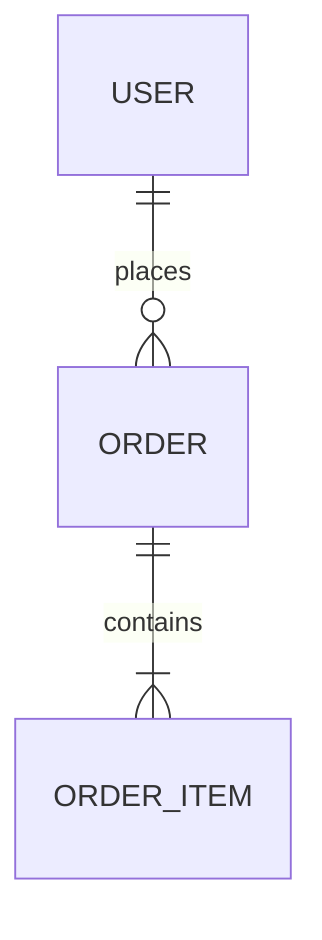
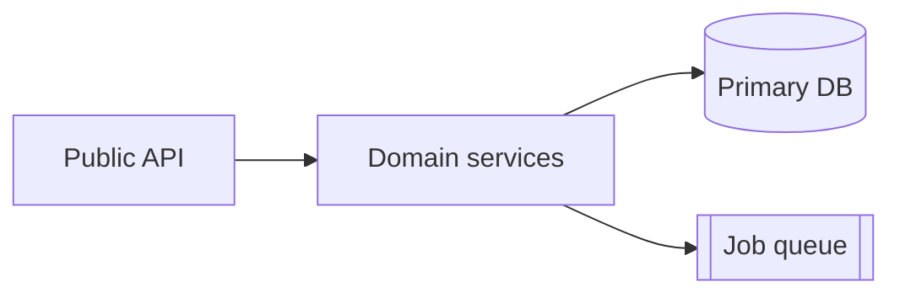

# Architecture (Tier 1 — STABLE)

Rules for this file:
- STABLE content only: data model, boundaries, conventions. No ticket-specific
  or fast-changing detail — that belongs in ticket files. Stability keeps this
  doc cache-friendly and trustworthy.
- Update it in the same session as any change to the data model or boundaries.
- Prefer mermaid: token-dense, unambiguous.

## System overview

<!-- 3-6 sentences: what this system does, for whom, key external dependencies. -->

## Data model

## Module boundaries

## Conventions

- <!-- naming, error handling, migration policy, testing expectations -->

## Key decisions (long-lived)

| decision | rationale | date |
|---|---|---|
| <!-- e.g. soft deletes everywhere --> | <!-- audit requirements --> | |
